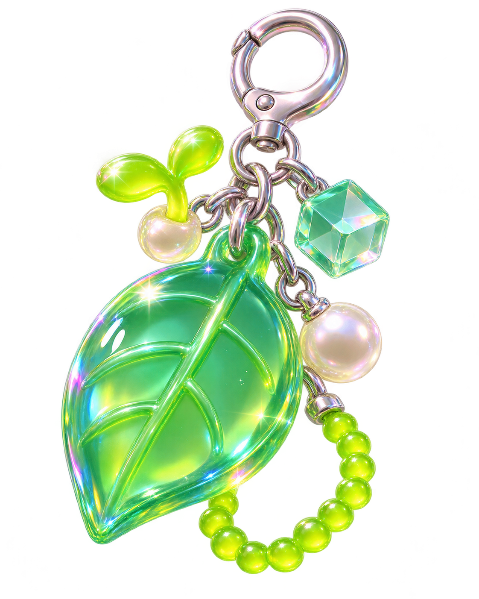

# 오행 POP 키링 — 제작·스타일·모션 가이드

버전: `fortune-pop-v1` · 작성: 2026-11-23 · 상태: 에셋 및 동작 탐색안, 서비스 적용 전.

## 목적과 파일

기존 코드 기반 잎·불꽃·둥근 큐브·네 갈래 별·물방울을, 매일 수집하고 싶은 복합적인 키링 그래픽으로 발전시킨다. 실루엣과 오행별 색의 구분은 유지하면서 젤리 레진·크롬·비즈의 촉감과 깊이를 추가했다.

- [에셋·모션 미리보기](../assets/fortune-pop-v1/index.html)
- [전체 생성 프롬프트 및 입력 역할](../assets/fortune-pop-v1/prompts.json)
- [파일 크기·해상도·SHA-256 매니페스트](../assets/fortune-pop-v1/manifest.json)
- [재사용 가능한 모션 코드](../assets/fortune-pop-v1/motion.js)

| 순서 / ID | 에셋 | 주인공 실루엣 | 오행별 구성과 소재 |
|---|---|---|---|
| 0 / `wood` | [목 PNG](../assets/fortune-pop-v1/wood.png) | 끝이 뾰족한 볼륨 있는 잎 | 에메랄드 반투명 잎, 라임 새싹·비즈, 민트 크리스털, 진주, 크롬 고리 |
| 1 / `fire` | [화 PNG](../assets/fortune-pop-v1/fire.png) | 끝이 말린 둥근 불꽃 | 핫핑크 젤리 외피와 오렌지 불꽃, 태양, 앰버 주사위, 핑크·오렌지 비즈 |
| 2 / `earth` | [토 PNG](../assets/fortune-pop-v1/earth.png) | 모서리가 둥근 큐브 | 호박색 투명 레진과 금빛 입자, 노란 조약돌, 사각 구멍 코인, 크림·캐러멜 비즈, 골드 고리 |
| 3 / `metal` | [금 PNG](../assets/fortune-pop-v1/metal.png) | 옆면이 오목한 네 갈래 별 | 미러 크롬, 라벤더·민트 반사, 라일락 크리스털, 하트 링, 실버·라일락 비즈 |
| 4 / `water` | [수 PNG](../assets/fortune-pop-v1/water.png) | 밑부분이 부푼 물방울 | 코발트·아이스블루 유리, 기포와 물결, 아쿠아 링, 진주·블루 비즈, 크롬 고리 |

오행의 상징 체계는 시각적 구분이다. 재물·건강 등 운세 결과를 계산하는 규칙이나 점수 모델을 의미하지 않는다. 미리보기의 헤드라인도 실제 운세 로직과 연결되지 않은 예시 문구다.

## 제작 방식

1. 기존 `prototypes/fortune-card.html`의 3D 아이콘 형태와 오행별 팔레트를 확인했다. 최초 제작 시 참조한 것은 sowon 작업 폴더에 있던 이전 버전이며, 현재 레포의 스토리형 프로토타입과 화면 구조는 다를 수 있다.
2. 사용자가 제공한 이미지 두 장은 재질·반사·키링 구성·팝한 분위기의 참고로 사용했다. 브랜드명·로고·기기·캐릭터·원본 배치를 복제하는 입력으로 쓰지 않았다.
3. 기존 카드 화면 캡처는 형태와 서비스 맥락을 전달하는 세 번째 참고 이미지로 사용했다. UI·텍스트는 생성물에서 제외했다.
4. 내장 `image_gen` 도구로 오행당 한 번씩 별도의 이미지를 생성했다. 공통 프롬프트에 오행별 피사체 설명을 붙이고 `transparent_background: true`를 지정했다. API/CLI 대체 경로는 사용하지 않았다.
5. 생성된 PNG를 그대로 보관하고 HTML/CSS/JavaScript 미리보기에 연결했다. 이미지 내부의 참·비즈를 수작업으로 분리하거나 3D 모델을 만든 것은 아니다.
6. 이후 PNG의 고리 위쪽을 회전축으로 잡아 감쇠 스프링 모션과 포인터 반응을 추가했다.

생성 도구의 정확한 모델 버전·seed는 기록되지 않았다. 참고 이미지 원본도 레포에 재배포하지 않는다. 따라서 프롬프트는 스타일과 제작 의도를 재현하는 기록이며 동일한 픽셀 결과를 보장하는 명세는 아니다. 앱 실행 중 이미지 생성 API를 호출할 필요는 없다.

## 공통 스타일 규칙

### 조형과 구성

- 각 에셋은 **하나의 연결된 키링 덩어리**로 읽혀야 한다. 상단 걸쇠 → 짧은 체인 → 큰 오행 참 → 보조 참·비즈 루프의 위계를 따른다.
- 주인공 참이 시각적 면적의 약 55%를 차지하도록 프롬프트에서 유도한다. 이는 생성 방향이며 엄밀한 픽셀 비율 검수 기준은 아니다.
- 보조 참은 2~3개를 기본으로 하고, 비즈 루프 하나로 리듬을 만든다. 관계없는 소품을 흩뿌리지 않는다.
- 정면보다 약간 돌아간 3/4 시점과 가벼운 대각선 기울기를 쓴다. 단, 작은 카드에서도 원래 실루엣을 알아볼 수 있어야 한다.
- 목·화·토·금·수는 각각 잎·불꽃·큐브·네 갈래 별·물방울로 고정한다. 토·수 내부의 작은 별 무늬는 컬렉션의 장식이며 금 오행으로 분류를 바꾸지 않는다.
- 고리와 체인은 연결이 가능한 구조로 보이게 한다. 새 버전에서도 접속부·교차·뜬 고리를 검수한다.

### 재질과 빛

- 기본 질감은 두껍고 둥근 투명 레진 또는 유리. 금은 크롬 반사가 중심이다.
- 투명한 내부 층·기포·금빛 입자·색 번짐과 금속의 하드한 반사를 함께 사용해 복잡도를 만든다.
- 미세한 표면감, 몰딩의 두께, 굴절과 프리즘 하이라이트로 촉감을 표현한다. 플랫한 벡터·매트한 플라스틱으로 바꾸지 않는다.
- 공통 광원은 좌상단의 부드러운 스튜디오 광원과 선명한 가장자리 하이라이트다. 작은 반짝임은 재질을 설명하는 위치에 둔다.
- 별도의 바닥·환경·큰 그림자·불투명 배경을 이미지 안에 굽지 않는다. 카드 배경은 CSS에서 따로 제어한다.

### 색상과 텍스트

- 목: 에메랄드·라임 / 화: 핑크·오렌지 / 토: 앰버·버터·크림 / 금: 실버·라일락 / 수: 코발트·아쿠아.
- 반사광은 다른 색을 포함할 수 있지만 주조색이 서로 구분돼야 한다.
- 이미지에는 글자·날짜·점수·로고·워터마크를 넣지 않는다. 서비스 문구는 HTML/UI 계층에서 렌더링한다.
- 미리보기의 배경 그라데이션 값은 카드용 CSS 값이다. 생성 이미지의 색을 수치적으로 보장하는 컬러 토큰은 아니다.

## 파일·배치 규칙

- 현재 원본은 모두 **1122 × 1402px, RGBA PNG**다. 프롬프트는 세로형 4:5 구도를 요청했고 실제 출력 크기는 매니페스트에 기록했다.
- 이름은 `wood.png`, `fire.png`, `earth.png`, `metal.png`, `water.png`. 인덱스 순서 `목→화→토→금→수`를 유지한다.
- 투명 배경을 유지한다. 흰색 배경이나 체크 패턴을 이미지에 합성하지 않는다.
- `object-fit: contain`으로 전체 실루엣을 표시한다. `cover`로 고리·비즈를 자르거나 가로세로 비율을 늘리지 않는다.
- 미리보기는 아트 영역 너비 82%, 최대 높이 88%의 래퍼를 사용해 회전 여백을 둔다. 실제 카드 적용 시 고리·비즈 끝이 잘리지 않는지 확인한다.
- 새 생성 결과는 `fortune-pop-v2`처럼 버전 폴더를 추가한다. 같은 파일명 아래 원본을 덮어써서 이미지와 모션 기준점이 조용히 바뀌지 않게 한다.
- 현재 PNG는 파일당 약 1.5~1.8MB다. 실제 제품 적용 시 필요한 것만 불러오고 실기기 메모리·번들 크기를 확인한다. WebP/AVIF 파생본을 만들 때도 원본과 알파를 보존하고 별도 파일로 둔다.
- 원본 패키지에는 중복 바이너리 ZIP을 커밋하지 않는다. 배포용 ZIP은 필요할 때 파일 묶음으로 만든다.

## 모션 규칙

### 동작 모델

PNG 전체를 고리 위쪽에 매단 진자로 취급한다. `requestAnimationFrame`에서 감쇠 스프링을 적분하고 CSS `rotate()`를 적용한다. 체인·참·비즈가 독립적으로 움직이는 리깅이나 영상 파일은 아니다.

```text
target = sin(time × frequency + phase) × amplitude
acceleration = (target − angle) × stiffness − velocity × damping
velocity += acceleration × dt
angle += velocity × dt
```

실제 구현은 프레임마다 2회 반 간격 적분한다. `dt`는 최대 0.035초, 각도는 ±14도, 포인터로 가하는 각속도는 ±65도/초로 제한한다. `phase`는 요소 인덱스 × 1.7이다. 스프링 값은 실제 질량 측정값이 아닌 시각적 튜닝 파라미터다.

| 오행 | stiffness | damping | amplitude(도) | frequency(rad/s) | kick(도/초) | transform-origin | 인상 |
|---|---:|---:|---:|---:|---:|---|---|
| 목 | 22 | 2.8 | 2.2 | 1.20 | 21 | 59% 7% | 가볍고 경쾌함 |
| 화 | 34 | 2.5 | 2.8 | 1.55 | 26 | 54% 7% | 탄력 있고 빠름 |
| 토 | 17 | 3.8 | 1.3 | 0.88 | 16 | 53% 7% | 묵직하고 느림 |
| 금 | 38 | 3.0 | 1.8 | 1.40 | 23 | 60% 7% | 짧고 또렷함 |
| 수 | 19 | 2.4 | 2.6 | 1.02 | 20 | 54% 7% | 부드럽고 유연함 |

고정축은 현재 PNG의 고리 위치를 보고 정했다. 에셋을 교체하면 피벗도 다시 맞춘다.

### 입력과 접근성

- 기본: 작은 진폭으로 계속 흔들린다. 놓았을 때 정지 자세로 수렴한 뒤 기본 흔들림이 이어진다.
- 마우스 진입: 진입 방향에 따라 작은 충격을 더한다.
- 터치/포인터 누름: 충격을 주고, 좌우 드래그 속도를 각속도에 반영한다. 놓으면 감쇠한다.
- `touch-action: pan-y`로 모바일의 세로 스크롤을 허용한다. 스크롤 시작으로 포인터가 취소되면 드래그 상태를 해제한다.
- 포커스한 에셋에서 Enter·Space·좌우 방향키로 흔들 수 있다. 실제 적용 시 포커스 테두리와 역할/접근 가능한 이름도 함께 제공한다.
- `찰랑임 켜짐/꺼짐`으로 전체 정지 가능. OS의 `prefers-reduced-motion: reduce`에서는 정지하고 토글을 비활성화한다.
- `IntersectionObserver`로 화면 밖 요소를 갱신하지 않고, 전체가 화면 밖이거나 탭이 숨겨지면 프레임 루프를 멈춘다.

### 다른 화면에 붙이기

`motion.js`는 프레임워크가 없는 미리보기용 IIFE다. DOM이 만들어진 후 한 번 로드하며, 각 `.art[data-element]`에 `.charm` 자식이 있어야 한다. `data-element`는 0~4만 허용한다. 실제 CSS는 [미리보기](../assets/fortune-pop-v1/index.html)를 참고한다.

```html
<div class="art" data-element="0" tabindex="0" role="button"
     aria-label="목 오행 키링. 드래그 또는 방향키로 흔들기">
  <div class="charm">
    
  </div>
</div>
<script src="/assets/fortune-pop-v1/motion.js"></script>
```

`motionToggle`·`shakeAll` 버튼은 선택 요소다. SPA에서 DOM을 다시 마운트하거나 여러 번 스크립트를 로드하는 사용법은 지원하지 않는다. React 등으로 옮길 때는 인스턴스별 초기화/해제와 옵서버·이벤트·RAF 정리 생명주기를 먼저 추가한다.

## 재생성·변경 절차

1. 바꾸려는 오행과 유지할 실루엣·색·고리 구조를 명시한다.
2. `prompts.json`의 해당 전체 프롬프트를 사용한다. 새로운 참고 입력의 역할을 재질·형태·구성 중 무엇인지 기록하고, 이미지 순서를 프롬프트와 맞춘다.
3. 한 오행당 한 이미지로 생성하고 투명 배경을 요청한다. 글자는 후처리 UI에 둔다.
4. 다른 네 개와 나란히 비교한다. 주조색, 크기, 광원, 하이라이트 강도, 보조 참 밀도, 고리 연결, 실루엣을 확인한다.
5. 화이트·다크·컬러·체크 배경에서 알파 가장자리와 과한 번짐을 확인한다. 360~390px 카드에서도 소재와 상징이 읽히는지 본다.
6. 버전 폴더·프롬프트·매니페스트·피벗을 함께 갱신한다. 크기·파일 수·SHA-256과 상대 경로를 검증한다.
7. 모션 켜기/끄기, 터치·키보드, 좁은 화면, OS 동작 줄이기와 화면 밖 동작 정지를 확인한다.

## 검증 상태와 남은 일

- 브라우저에서 5개 이미지 로드·데스크톱 레이아웃·390px 화면의 가로 넘침 없음 확인.
- 흔들기 입력으로 각도가 변하는 것, 정지 시 0도 복귀, OS 동작 줄이기 에뮬레이션에서 정지 확인.
- 현재 산출물은 독립 미리보기다. 운세 계산·스토리 화면·공유 기능에 연결하지 않았다.
- 실제 iOS/Android·토스 WebView의 터치 감각·스크롤 충돌·메모리·성능은 아직 검증하지 않았다.
- 체인과 비즈의 개별 지연 운동을 원하면 파츠 분리나 별도 3D 리깅이 필요하다. 현재 PNG만으로 해당 동작을 구현했다고 주장하지 않는다.
